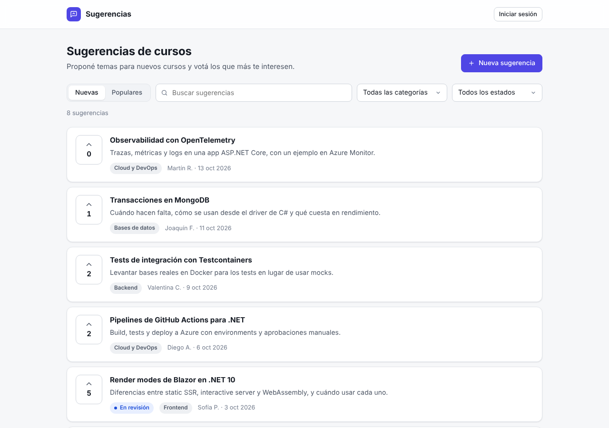
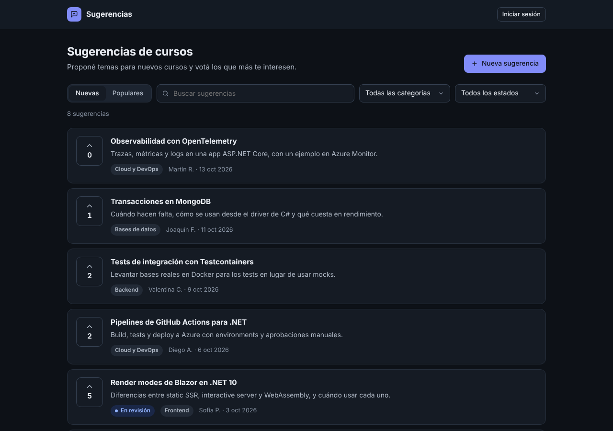
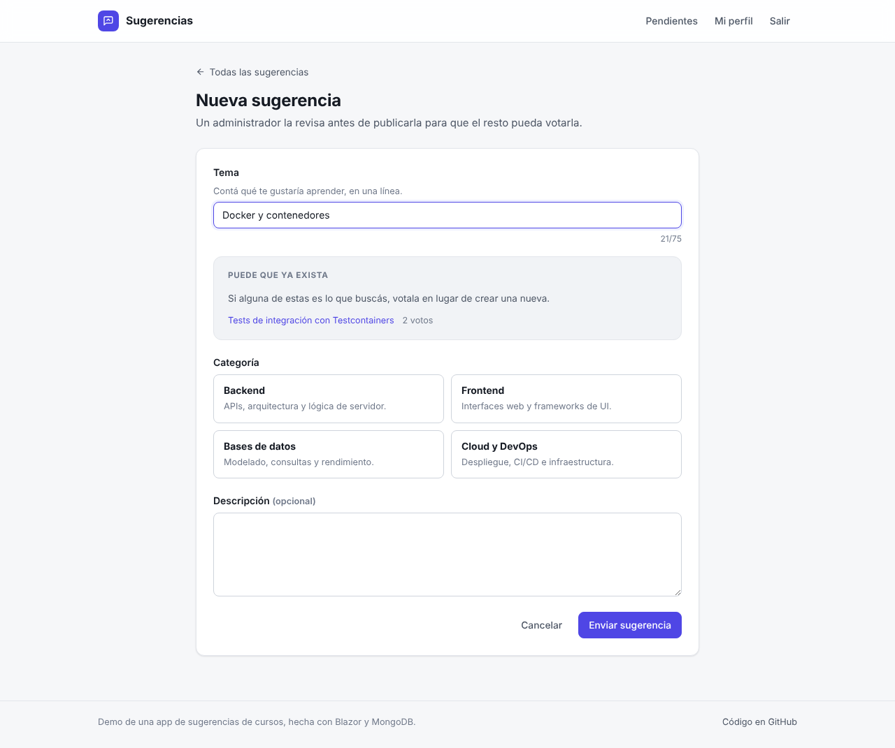
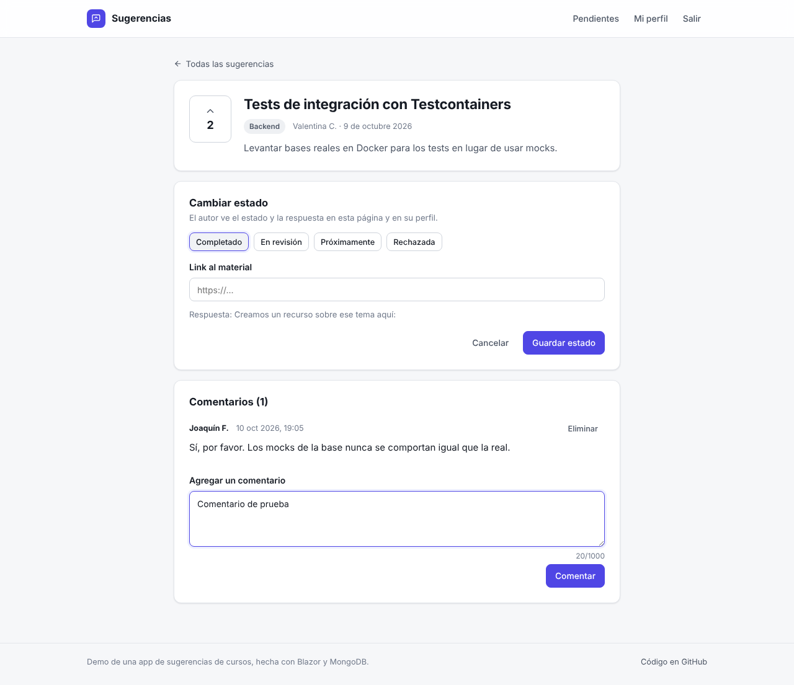
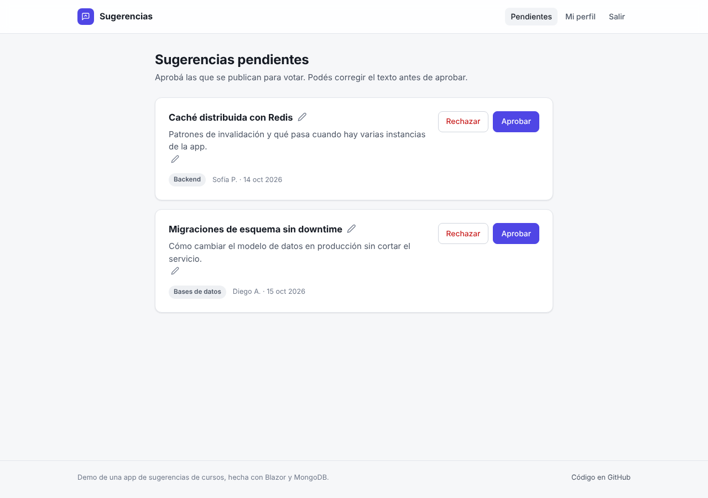
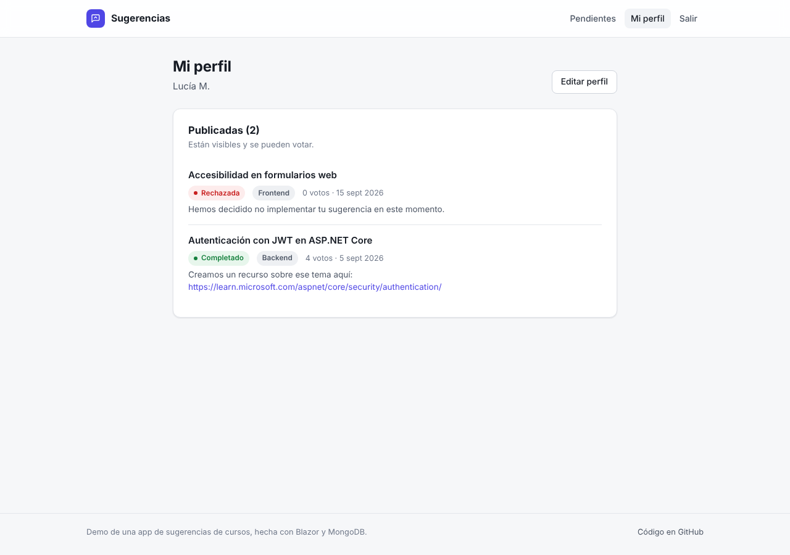
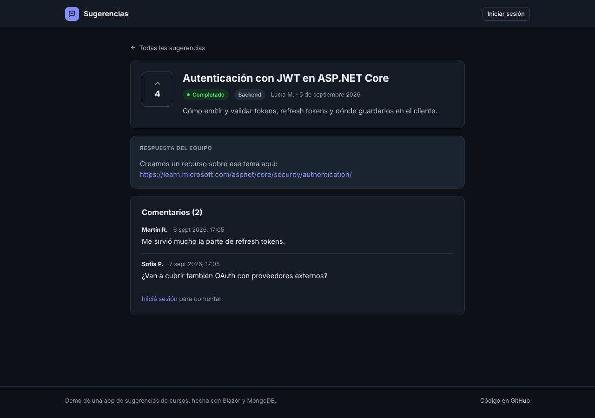
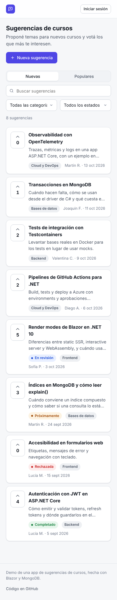

# Course Suggestions Application

Welcome to the **Course Suggestions Application**! This project provides a full-stack solution that allows users to create and vote on suggestions for new courses. Administrators can manage, approve, archive suggestions, and perform additional tasks through a robust administrative panel.

**See live**: https://fbappsugerenciasdemo.azurewebsites.net/

**Admin Credentials for testing**:

User: `testeoAppSugerencias@outlook.com`
Password: `AppSugerencias1`

## Features

- **Suggestions and votes**: users propose course topics and vote for the ones they want. Votes update live on every open page.
- **Similar suggestions**: while typing a new suggestion, the app shows existing ones with similar words (MongoDB text index with Spanish stemming), so people vote instead of creating duplicates.
- **Comments** on each suggestion. Admin comments are marked, and admins can delete comments.
- **Admin tools**: approve or reject new suggestions, edit their text, set a status (with a link to the published material) and archive them.
- **Public read-only API** with an OpenAPI document at `/openapi/v1.json` and a reference page at `/api/docs`.
- **Demo data**: an empty database gets sample data on startup. With `Demo:ReinicioAutomatico` enabled, the sample data is restored every `Demo:HorasEntreReinicios` hours, because the admin account is public.
- **Authentication** with Azure AD B2C, using a custom page template that matches the app.

## Full-Stack Solution

- **Backend**: C# on .NET 10.
- **Frontend**: Blazor Web App with interactive server rendering. Plain CSS with light and dark themes, no UI framework.
- **Database**: MongoDB. Creating and voting on suggestions use transactions, so the server must be a replica set.
- **Tests**: xUnit and bUnit. Data access tests run against a real MongoDB started with Testcontainers.
- **Deployment**: Azure Web App, deployed by GitHub Actions on every push to `master`.

## Running locally

Requirements: .NET 10 SDK and Docker.

1. Start MongoDB as a single-node replica set:

   ```bash
   docker run -d --name mongo-sugerencias -p 27017:27017 mongo:8 --replSet rs0
   docker exec mongo-sugerencias mongosh --quiet --eval 'rs.initiate({_id:"rs0",members:[{_id:0,host:"localhost:27017"}]})'
   ```

2. Run the app: `dotnet run --project AppSugerenciasUI`. In Development it connects to `mongodb://localhost:27017/?replicaSet=rs0&directConnection=true` (see `appsettings.Development.json`).

To use another database, set the connection string with user-secrets (`dotnet user-secrets set "ConnectionStrings:MongoDB" "<connection string>" --project AppSugerenciasUI`) or the `ConnectionStrings__MongoDB` environment variable. In Azure it is an App Setting. It is never stored in the repository.

The `categorias` and `estados` collections must have data before suggestions can be created.

## API

| Endpoint | Description |
| --- | --- |
| `GET /api/sugerencias?categoria=&estado=&q=&orden=nuevas\|populares` | Approved suggestions |
| `GET /api/sugerencias/{id}` | One approved suggestion |
| `GET /api/sugerencias/{id}/comentarios` | Its comments |
| `GET /api/categorias`, `GET /api/estados` | Categories and statuses |

The API does not expose who voted, only the number of votes.

## Azure AD B2C login page

`AppSugerenciasUI/wwwroot/b2c/plantilla.html` is the template for the B2C pages. To use it, in the Azure portal open the B2C tenant, go to **User flows**, open each flow (`B2C_1_susi`, `B2C_1_reset`, `B2C_1_edit`) and in **Page layouts** set **Use custom page content** to *Yes* with the URL `https://<app>.azurewebsites.net/b2c/plantilla.html`. The app sends the CORS header B2C needs for that path.

## Tests

```bash
dotnet test
```

Docker must be running, because the data access tests start a MongoDB container.

## Screenshots

Suggestion list, light and dark theme:





New suggestion form. While the user types, it lists existing suggestions with similar words:



Suggestion page as an admin, with the status panel and comments:



Pending suggestions, where an admin approves, rejects or edits them:



Profile with the suggestions a user created, their status and the admin's answer:



Suggestion page in the dark theme, and the list on a phone:




